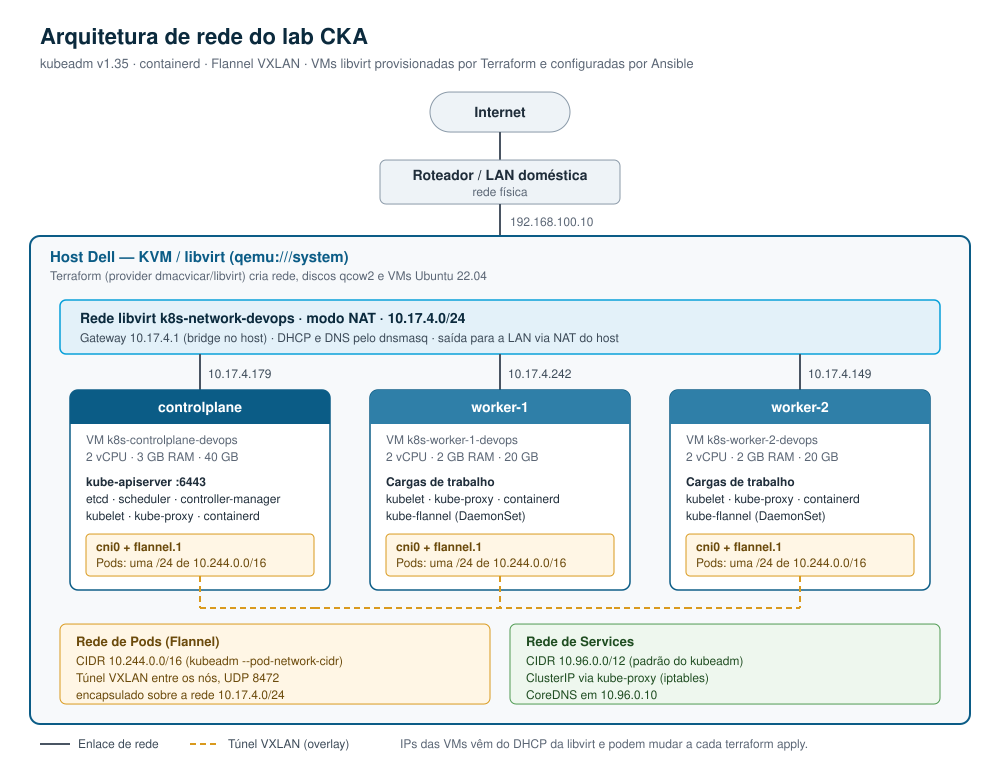

# CKA Kubernetes Cluster

Laboratório Kubernetes de três nós para estudo da certificação CKA, criado do zero com infraestrutura como código. O Terraform provisiona as VMs no KVM/libvirt, o Ansible instala e inicializa o cluster com kubeadm, e o Flannel cuida da rede de Pods.

Um único comando (`./lab_up.sh`) entrega um cluster funcional com um control plane e dois workers. Outro (`./lab_down.sh`) remove tudo.

## Arquitetura de rede



O host roda o KVM/libvirt e cria uma rede NAT isolada para o cluster. As VMs recebem IP por DHCP dentro dessa rede e saem para a internet pelo NAT do host. Sobre ela, o Flannel monta um túnel VXLAN que conecta os Pods de todos os nós.

| Camada | Faixa | Origem |
| --- | --- | --- |
| Rede das VMs (libvirt NAT) | `10.17.4.0/24`, gateway `10.17.4.1` | `terraform/variables.tf` (`lab_network_cidr`) |
| Rede de Pods (Flannel VXLAN) | `10.244.0.0/16`, uma `/24` por nó | `kubeadm init --pod-network-cidr` |
| Rede de Services (ClusterIP) | `10.96.0.0/12`, CoreDNS em `10.96.0.10` | padrão do kubeadm |

### Nós

| Nó | VM libvirt | vCPU | RAM | Disco | Função |
| --- | --- | --- | --- | --- | --- |
| controlplane | `k8s-controlplane-devops` | 2 | 3 GB | 40 GB | kube-apiserver (6443), etcd, scheduler, controller-manager |
| worker-1 | `k8s-worker-1-devops` | 2 | 2 GB | 20 GB | Cargas de trabalho |
| worker-2 | `k8s-worker-2-devops` | 2 | 2 GB | 20 GB | Cargas de trabalho |

Os recursos e a quantidade de workers são variáveis do Terraform. Os IPs são atribuídos por DHCP e o Terraform grava os valores atuais em `ansible/inventory.ini` a cada `apply`.

## Stack

| Componente | Versão / detalhe |
| --- | --- |
| Sistema das VMs | Ubuntu 22.04 (cloud image Jammy) |
| Virtualização | KVM / libvirt (`qemu:///system`) |
| Provisionamento | Terraform com provider `dmacvicar/libvirt` 0.6.14 |
| Configuração | Ansible |
| Kubernetes | v1.35 (kubeadm, kubelet, kubectl fixados com `apt-mark hold`) |
| Container runtime | containerd com `SystemdCgroup = true` e `pause:3.10` |
| CNI | Flannel v0.28.10 (VXLAN), versão fixada no playbook |

## Estrutura do repositório

```text
.
├── ansible/
│   ├── inventory.ini        # Gerado pelo Terraform (fora do Git)
│   └── playbook.yml         # Prepara os nós, inicializa o control plane e faz o join
├── terraform/
│   ├── main.tf              # Rede NAT, imagem base, discos, VMs e inventário
│   ├── variables.tf         # CIDR, vCPU, memória, quantidade de workers e chave SSH
│   ├── cloud-init.yaml      # Hostname, usuário e pacotes iniciais das VMs
│   └── .terraform.lock.hcl  # Versões travadas dos providers
├── docs/
│   └── arquitetura-rede.svg # Diagrama de rede
├── k8s-manifests/           # Manifestos de estudo (em construção)
├── lab_up.sh                # Provisiona as VMs e configura o cluster
├── lab_down.sh              # Destrói VMs, discos e rede
├── liga_cluster.sh          # Liga as VMs existentes
├── desliga_cluster.sh       # Desliga as VMs de forma graciosa
├── monitor.sh               # Acompanha o provisionamento (imagens, processos, VMs)
├── bootstrap_lab.sh         # Confere se o host tem tudo para rodar o lab
└── RELATORIO_INTERVENCAO.md # Registro de manutenção e troubleshooting do cluster
```

## Pré-requisitos no host

- KVM e libvirt (`qemu-kvm`, `libvirt-daemon-system`, `libvirt-clients`)
- Storage pool `default` do libvirt ativo
- Terraform
- Ansible com a coleção `community.general` (já incluída no pacote `ansible`)
- `genisoimage`, usado pelo provider libvirt para gerar o disco do cloud-init
- Chave SSH em `~/.ssh/id_ed25519` (gere com `ssh-keygen -t ed25519`)
- Cerca de 7 GB de RAM livres para as três VMs

O `bootstrap_lab.sh` confere todos esses itens e diz o que falta:

```bash
./bootstrap_lab.sh
```

## Como usar

### Criar o lab do zero

```bash
chmod +x *.sh
./lab_up.sh
```

O script executa duas etapas:

1. `terraform apply` cria a rede `k8s-network-devops`, baixa a imagem do Ubuntu, cria os discos e as VMs com a sua chave SSH e gera o inventário do Ansible.
2. `ansible-playbook` espera o SSH e o cloud-init de cada VM, prepara os nós e monta o cluster.

No final, ele mostra o comando SSH para o control plane.

### Ligar e desligar sem destruir

```bash
./liga_cluster.sh      # virsh start nas VMs k8s-*
./desliga_cluster.sh   # virsh shutdown nas VMs k8s-*
```

### Destruir tudo

```bash
./lab_down.sh
```

## O que o playbook faz

| Etapa | Hosts | Ações |
| --- | --- | --- |
| Aguardar as VMs | todos | Espera o SSH responder e o cloud-init terminar (até 5 minutos) |
| Preparar os nós | todos | Desliga o swap, carrega `overlay` e `br_netfilter`, ajusta o sysctl, instala containerd, kubelet, kubeadm e kubectl v1.35 |
| Inicializar o control plane | controlplane | `kubeadm init` com `--pod-network-cidr=10.244.0.0/16`, copia o kubeconfig para o root, aplica o Flannel v0.28.10 e gera o comando de join |
| Unir os workers | workers | `kubeadm join` (somente se o nó ainda não estiver no cluster) |

As etapas de init e join verificam se já foram executadas, então o playbook pode ser rodado novamente sem recriar o cluster.

## Acessar o cluster

O kubeconfig de administrador fica no control plane, no usuário root:

```bash
ssh ubuntu@$(terraform -chdir=terraform output -raw controlplane_ip)
sudo -i
kubectl get nodes -o wide
kubectl get pods -A
```

## Segurança

O acesso às VMs é feito somente por chave SSH: o cloud-init instala a sua chave pública no usuário `ubuntu`, bloqueia a senha e desliga o login SSH por senha. Os caminhos das chaves ficam em `ssh_public_key_path` e `ssh_private_key_path` (`terraform/variables.tf`).

A checagem da chave de host está desativada no inventário de propósito: as VMs são recriadas a cada `lab_up.sh` e reaproveitam IPs do DHCP, o que geraria alertas falsos de troca de chave. Isso é aceitável numa rede NAT isolada de laboratório, não em produção.

O `ansible/inventory.ini` e o `terraform.tfvars` ficam fora do Git, assim como o estado do Terraform.

## Tópicos de estudo da CKA

O cluster serve de base para praticar:

- Troubleshooting de nós, Pods e componentes do control plane
- RBAC
- NetworkPolicies (o Flannel não aplica essas regras; para praticar, é preciso um CNI como Calico ou Cilium)
- Backup e restore do etcd
- Scheduling: taints, tolerations e affinity
- Upgrade do cluster com kubeadm
